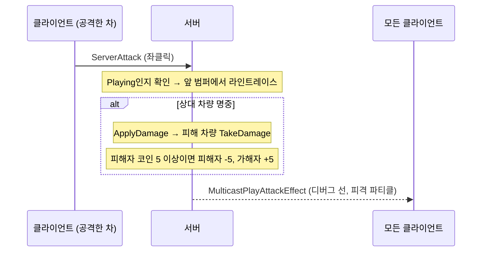

# 4CH_2_Racing - 분노의 질주: 원화 채굴

제한 시간 동안 맵에 놓인 코인을 모으고, 다른 차를 공격해서 코인을 빼앗는 멀티플레이 차량 배틀 게임입니다.
게임 진행(대기 → 진행 → 종료), 아이템 획득, 공격 판정은 모두 서버에서 처리하고, 클라이언트는 입력과 화면 표시만 맡도록 만들었습니다.

- 엔진: Unreal Engine 5.6 (C++, Vehicle 템플릿 기반)
- 과제: 내일배움캠프 Unreal 10기 CH4 2번 과제
- 시연 영상: (추가 예정)

---

## 실행 방법

1. `CX.uproject`를 열고 `Content/VehicleTemplate/Maps/VehicleAdvExampleMap` 맵을 엽니다.
2. Play 옵션에서 Net Mode를 Play As Listen Server, Number of Players를 2로 두고 실행합니다.
3. 조작
   - 운전: 차량 템플릿 기본 조작
   - 공격: 마우스 왼쪽 클릭
   - 채팅: 운전 중 Enter → 입력 → Enter로 전송 (빈 칸에서 Enter를 누르면 운전으로 돌아감)

---

## 게임 규칙

- 첫 플레이어가 접속하면 10초 대기 카운트다운이 시작됩니다. 마지막 5초는 화면 가운데에 `5, 4, 3, 2, 1`, 시작할 때 `GO!`가 뜹니다.
- 대기 중에는 차가 핸드브레이크로 고정되어 움직일 수 없습니다.
- 60초 동안 코인(+10원)과 스피드 버프(최대 속도 +10km/h)를 모읍니다. 먹은 아이템은 2초 뒤 같은 자리에 다시 생깁니다.
- 상대 차를 맞히면 상대가 5원 이상 가지고 있을 때 5원을 빼앗습니다. 5원 미만이면 아무 일도 일어나지 않습니다.
- 시간이 끝나면 코인이 가장 많은 플레이어가 승리하고, 최고 코인이 같으면 공동 우승입니다. 화면에 `WIN` / `LOSE`가 표시됩니다.
- 기본 최대 속도는 150km/h이고, 스피드 버프를 먹을 때마다 상한이 10km/h씩 올라갑니다.

---

## 구현 기능

### 필수 기능
- **채팅**: 채팅 위젯(`UChatUI`) → Server RPC → 모든 PlayerController에 Client RPC, 늦게 들어온 플레이어를 위한 채팅 기록(`UChatSubsystem`)
- **PlayerState**: 코인(`Coins`)과 추가 최대 속도(`BonusMaxSpeed`)를 `COND_OwnerOnly`로 복제, 값 변경은 서버에서만
- **공격**: 좌클릭 → Server RPC → 앞 범퍼 중앙에서 라인트레이스 → `ApplyDamage` → `TakeDamage`에서 코인 이동, `DrawDebugLine`과 피격 파티클
- **아이템**: 코인 / 스피드 버프 액터, `NetUpdateFrequency` 1, 겹치면 효과 적용 후 파괴, 파괴 시 파티클과 사운드
- **스포너**: 아이템을 스폰하고 `OnDestroyed`를 구독해서 2초 뒤 같은 종류로 리스폰
- **GameState / GameMode**: `ECXMatchState`(Waiting / Playing / Finished), 남은 시간, 우승자 목록 복제, 1초 서버 타이머, 공동 우승 처리, 승패 UI

### 도전 기능 (5. 게임 상태별 제약)
- `Playing`일 때만 가속, 조향, 공격, 차량 위치 초기화, 아이템 획득이 됩니다.
- `Waiting` / `Finished`에서는 스로틀과 조향을 0으로, 핸드브레이크를 true로 유지하고, `Playing`이 되면 잠금을 자동으로 풉니다.

### 추가로 넣은 것
- 운전 중 Enter로 채팅 입력창 열기, 전송하면 바로 운전으로 복귀
- HUD: 위 가운데에 상태와 남은 시간(`0:45` 형식), 왼쪽 위에 코인과 최대 속도, 가운데에 카운트다운 / `GO!` / `WIN` / `LOSE`
- 코인과 별 모양 아이템 메시, 회전 연출, 획득 사운드, 폭발 파티클

---

## 구현 과정

### 1. 채팅
강의를 따라 `UChatUI` 위젯 클래스를 만들고, `BindWidget`으로 입력창과 로그창을 C++ 변수에 연결했습니다. Enter로 확정된 문장은 PlayerController의 Server RPC로 서버에 보내고, 서버가 모든 PlayerController에 Client RPC를 보내 각자 화면에 띄웁니다. 채팅 기록은 `UWorldSubsystem`에 저장해 두고, 새로 접속한 플레이어에게 `PostLogin`에서 한 번에 보내 줍니다.

### 2. PlayerState
코인과 추가 최대 속도는 "자기 화면에서만" 보면 되는 값이라 `COND_OwnerOnly`로 복제했습니다. 값을 바꾸는 함수는 맨 앞에서 `HasAuthority()`를 확인해서 클라이언트에서 불러도 무시되게 했습니다.

### 3. 아이템과 스포너
코인과 스피드 버프는 "겹치면 효과 → 파괴 → 연출"이라는 흐름이 같아서 공통 부모 `ACXItemBase`를 만들고, 효과만 자식 클래스가 정하게 했습니다. 스포너는 아이템 종류(`ItemClass`)를 레벨에서 고를 수 있어서, 같은 클래스로 코인 스포너와 버프 스포너를 모두 배치했습니다.

### 4. 공격
좌클릭은 Server RPC만 호출하고, 라인트레이스와 데미지 판정은 서버에서 합니다. 판정 결과(선의 시작 / 끝, 맞았는지)는 NetMulticast RPC로 보내서 모든 화면에 디버그 선과 파티클이 보이게 했습니다.

### 5. 게임 상태
GameMode가 1초 타이머로 GameState의 남은 시간을 줄이고, 0이 되면 Waiting → Playing → Finished로 넘깁니다. 상태와 시간, 우승자 목록은 GameState 복제 변수라서 모든 플레이어가 같은 값을 봅니다. HUD는 PlayerController의 Tick에서 PlayerState와 GameState 값을 읽어 갱신합니다.

### 6. 게임 상태별 제약
테스트 중에 종료 후에도 코인이 바뀌어 승패가 뒤집히는 문제가 생겨서(아래 트러블슈팅 1번), 도전 기능 5번을 함께 구현했습니다.

---

## 구조

### 클래스별 역할
- `ACXGameMode` (서버에만 존재): 1초 경기 타이머, 상태 전환, 우승자 계산, 접속 시 채팅 기록 전달
- `ACXGameState` (서버와 모든 클라이언트): `MatchState`, `RemainingTime`, `Winners` 복제
- `ACXPlayerState`: `Coins`, `BonusMaxSpeed` (소유자에게만 복제)
- `ACXPlayerController`: 채팅 RPC, HUD 갱신, Enter로 채팅 열기
- `ACXPawn`: 공격 Server RPC / Multicast, `TakeDamage`에서 코인 이동, 최대 속도 제한, 게임 상태별 입력 잠금
- `ACXItemBase` → `ACXCoinItem`, `ACXSpeedBuffItem`: 겹침 판정(서버), 효과, 파괴 연출
- `ACXItemSpawner`: 스폰, `OnDestroyed` 구독, 2초 뒤 리스폰
- `UCXUI`, `UChatUI`: HUD 텍스트, 채팅 위젯
- `UChatSubsystem`: 채팅 기록 저장

### 공격했을 때



### 경기 타이머 (서버에서 1초마다)
1. 남은 시간을 1 줄입니다. 아직 0이 아니면 끝입니다.
2. Waiting이었으면 Playing으로 바꾸고 남은 시간을 플레이 시간(60초)으로 채웁니다.
3. Playing이었으면 Finished로 바꾸고 타이머를 멈춘 뒤 우승자를 계산합니다.

---

## 핵심 코드

길어지는 부분은 `...`로 줄였습니다.

### 1. 소유자에게만 복제되는 코인, 서버에서만 변경
```cpp
// CXPlayerState.cpp
void ACXPlayerState::GetLifetimeReplicatedProps(TArray<FLifetimeProperty>& OutLifetimeProps) const
{
	Super::GetLifetimeReplicatedProps(OutLifetimeProps);

	DOREPLIFETIME_CONDITION(ThisClass, Coins, COND_OwnerOnly);
	DOREPLIFETIME_CONDITION(ThisClass, BonusMaxSpeed, COND_OwnerOnly);
}

void ACXPlayerState::AddCoins(int32 Amount)
{
	if (HasAuthority() == false)
	{
		return;
	}

	Coins += Amount;
}
```

### 2. 아이템 파괴 연출을 모든 화면에서
서버에서 `Destroy()`하면 클라이언트의 같은 액터도 `EndPlay(Destroyed)`가 불립니다. 그래서 파티클과 사운드를 `EndPlay`에서 재생하면 RPC 없이도 모든 플레이어가 연출을 봅니다. 레벨 종료 같은 다른 이유로 사라질 때는 연출을 건너뜁니다.
```cpp
// CXItemBase.cpp
void ACXItemBase::EndPlay(const EEndPlayReason::Type EndPlayReason)
{
	if (EndPlayReason == EEndPlayReason::Destroyed)
	{
		if (IsValid(DestroyParticle))
		{
			UGameplayStatics::SpawnEmitterAtLocation(this, DestroyParticle, GetActorLocation());
		}
		...
	}

	Super::EndPlay(EndPlayReason);
}
```

### 3. 스포너: OnDestroyed 구독 후 2초 뒤 리스폰
```cpp
// CXItemSpawner.cpp
void ACXItemSpawner::SpawnItem()
{
	...
	SpawnedItem = GetWorld()->SpawnActor<ACXItemBase>(ItemClass, GetActorTransform(), SpawnParameters);
	if (IsValid(SpawnedItem))
	{
		SpawnedItem->OnDestroyed.AddDynamic(this, &ThisClass::OnSpawnedItemDestroyed);
	}
}

void ACXItemSpawner::OnSpawnedItemDestroyed(AActor* DestroyedActor)
{
	SpawnedItem = nullptr;
	...
	GetWorldTimerManager().SetTimer(RespawnTimerHandle, this, &ThisClass::SpawnItem, RespawnDelay, false);
}
```

### 4. 공격 판정과 코인 이동
```cpp
// CXPawn.cpp
void ACXPawn::ServerAttack_Implementation()
{
	if (IsMatchPlaying() == false) // 클라이언트를 믿지 않고 서버에서도 검사
	{
		return;
	}

	const FVector TraceStart = GetActorTransform().TransformPosition(AttackTraceStartOffset); // 앞 범퍼 중앙
	const FVector TraceEnd = TraceStart + GetActorForwardVector() * AttackRange;
	...
	ACXPawn* HitVehicle = bHit ? Cast<ACXPawn>(HitResult.GetActor()) : nullptr;
	if (IsValid(HitVehicle))
	{
		UGameplayStatics::ApplyDamage(HitVehicle, 1.0f, GetController(), this, UDamageType::StaticClass());
	}

	MulticastPlayAttackEffect(TraceStart, bHit ? FVector(HitResult.ImpactPoint) : TraceEnd, IsValid(HitVehicle));
}

float ACXPawn::TakeDamage(float DamageAmount, FDamageEvent const& DamageEvent, AController* EventInstigator, AActor* DamageCauser)
{
	...
	// 피해 차량이 5원 미만이면 아무것도 안 함
	if (VictimPlayerState->GetCoins() < StealCoinAmount)
	{
		return ActualDamage;
	}

	VictimPlayerState->RemoveCoins(StealCoinAmount);
	AttackerPlayerState->AddCoins(StealCoinAmount);
	...
}
```

### 5. 우승자 계산 (공동 우승)
```cpp
// CXGameMode.cpp
for (APlayerState* PlayerState : CXGameState->PlayerArray)
{
	ACXPlayerState* CXPlayerState = Cast<ACXPlayerState>(PlayerState);
	...
	const int32 Coins = CXPlayerState->GetCoins();
	if (Coins > HighestCoins)
	{
		HighestCoins = Coins;
		CXGameState->Winners.Reset();
		CXGameState->Winners.Add(CXPlayerState);
	}
	else if (Coins == HighestCoins)
	{
		CXGameState->Winners.Add(CXPlayerState); // 최고 원화가 같으면 공동 우승
	}
}
```

### 6. 게임 상태별 입력 잠금
```cpp
// CXPawn.cpp (Tick)
if (IsLocallyControlled())
{
	if (IsMatchPlaying() == false)
	{
		ChaosVehicleMovement->SetThrottleInput(0.0f);
		ChaosVehicleMovement->SetSteeringInput(0.0f);
		ChaosVehicleMovement->SetHandbrakeInput(true);
		bMatchHandbrakeLocked = true;
	}
	else if (bMatchHandbrakeLocked) // Playing이 되면 게임 상태용 잠금만 해제
	{
		ChaosVehicleMovement->SetHandbrakeInput(false);
		bMatchHandbrakeLocked = false;
	}
}
```

---

## 고민했던 부분

### 1. "추가 최대 속도"를 어떻게 적용할까
Chaos 차량 컴포넌트에는 최대 속도 설정이 따로 없어서(`ChaosVehicleMovementComponent.h`에 `MaxSpeed`가 주석 처리되어 있음), 차량에 기본 최대 속도(`BaseMaxSpeed`)를 두고 `기본 + BonusMaxSpeed`를 넘으면 가속 입력을 0으로 만드는 방식으로 상한을 걸었습니다. 처음에는 100km/h로 했는데, 플레이해 보니 2단 기어에서 막혀 답답해서 150km/h로 올렸습니다. 평소에는 제한이 거의 느껴지지 않고, 버프를 먹을수록 더 빨라지는 걸 체감할 수 있습니다.

### 2. 결승선을 넣을까
레이싱 게임이라 결승선을 넣는 것도 생각했지만, 과제의 우승 조건이 "가장 많은 원화"라서 결승선을 넣으면 먼저 들어온 사람과 코인이 많은 사람 중 누가 이기는지가 꼬입니다. 그래서 제한 시간 동안 코인을 모으는 배틀 방식으로 두고, 남은 시간을 HUD 위 가운데에 크게 보여 주도록 했습니다.

### 3. 남은 시간 동안 무엇을 할까
도전 기능 4번(부위 공격, 지뢰)과 5번(게임 상태별 제약) 중에서, 5번은 종료 후 승패가 뒤집히는 버그를 함께 해결하고 대기 중 출발선 정지 → GO 같은 흐름도 만들어 줘서 먼저 구현했습니다. 4번은 남은 시간에 비해 작업량이 커서 이번에는 넣지 않았습니다.

---

## 트러블슈팅

### 1. 종료 후 승패가 뒤집힘
2인 테스트에서 서버는 코인 0개인데 `WIN`, 클라이언트는 10개인데 `LOSE`가 나왔습니다. 우승자는 종료 순간에 정해지는데, 종료 뒤에도 코인 획득과 공격이 계속 가능해서 화면의 코인 수가 바뀐 것이었습니다. 아이템 획득과 공격을 `Playing` 상태에서만 허용하도록 바꿔서 해결했습니다. (도전 기능 5번)

### 2. 피격 파티클과 버프 사운드가 사라지지 않음
공격 이펙트로 쓴 `P_Sparks`와 버프 사운드로 쓴 `Light02_Cue`가 한 번 재생된 뒤 계속 남았습니다. 코드는 한 번만 재생하지만, 두 에셋 자체가 반복 재생(Looping)으로 만들어진 환경용 에셋이었습니다. 한 번만 재생되는 폭발 파티클과 획득 사운드로 바꿨습니다.

### 3. 위젯 바인딩 오류 (채팅)
`BindWidget` 변수를 Slate 클래스(`SEditableTextBox`)로 선언해서 UHT 오류가 났고, 위젯 블루프린트에는 `Editable Text`를 놓아서 C++ 변수(`UEditableTextBox`)와 타입이 맞지 않았습니다. UMG 클래스(`UEditableTextBox`)로 고치고, 팔레트의 `Text Box`(= `UEditableTextBox`)로 다시 배치해서 이름과 타입을 모두 맞췄습니다.

### 4. 운전 중에는 채팅을 칠 수 없음
게임이 키보드와 마우스 입력을 모두 가져가서 채팅창을 클릭할 수 없었습니다. PlayerController의 `InputKey`에서 Enter를 받으면 입력 모드를 UI 전용으로 바꾸고 채팅창에 포커스를 주고, 전송하면 다시 `GameOnly`로 돌려서 운전으로 돌아오게 했습니다.

---

## 아쉬운 점과 다음에 해보고 싶은 것
- 도전 기능 4번(바퀴 부위 공격과 속도 패널티, F키 지뢰)을 구현하지 못했습니다.
- 트랙 밖으로 나가면 속도를 낮추는 코스 이탈 패널티를 넣어서, 트랙을 따라 달릴 이유를 만들고 싶습니다.
- 공격 표시가 디버그 선이라 레이싱 게임다운 연출(총알 궤적, 카메라 흔들림)로 바꾸고 싶습니다.
